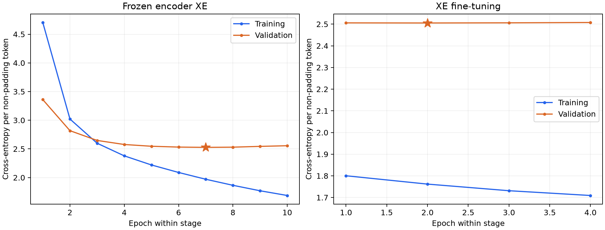
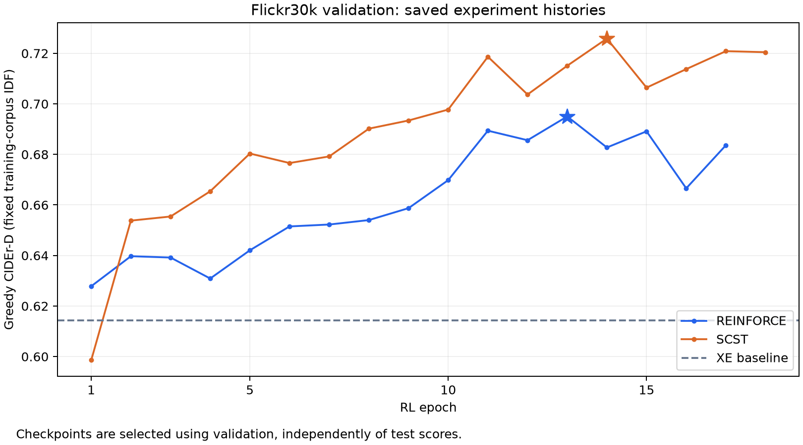
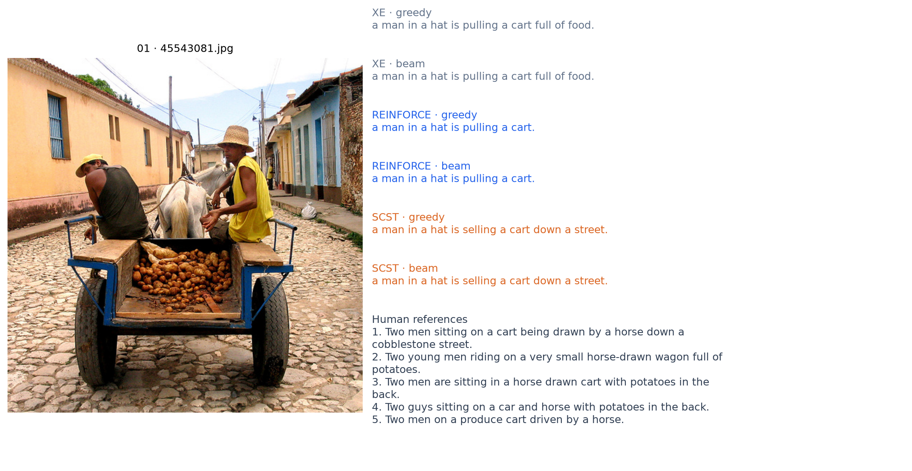
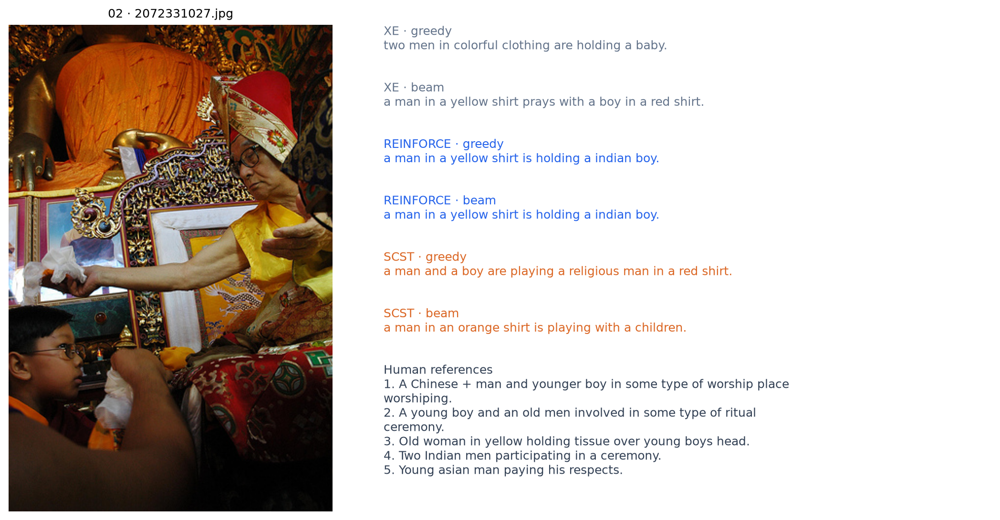
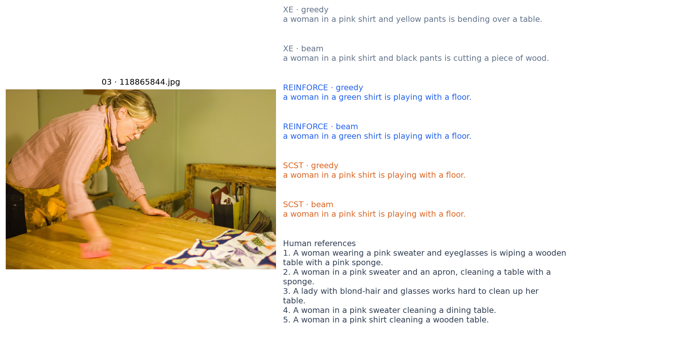

# Learning to Describe Images

A PyTorch image captioner that compares cross-entropy training, REINFORCE, and self-critical sequence training on Flickr30k.

> **Work in progress — not the final version.** The current REINFORCE and SCST results use Adam and are provisional. We plan to rerun both methods with AdamW from the same fine-tuned XE checkpoint, with weight decay explicitly configured and documented. Existing Adam checkpoints and results will be retained as a baseline; AdamW results are not yet available.

## Overview

This project turns an image into a sentence using a pretrained Vision Transformer and a custom Transformer decoder. The decoder, training loops, reward integration, and generation pipeline are implemented to explore how image features become words—and whether optimizing a caption-level reward improves on next-token prediction.

The project follows a CPTR-inspired design, with staged encoder fine-tuning, reproducible dataset splits, checkpoint provenance, and cached decoding. The encoder weights and tokenizer are pretrained; the caption decoder is trained from scratch.

## Methodology

### Architecture and vocabulary

| Component | Implementation |
| --- | --- |
| Encoder | Pretrained `google/vit-base-patch16-384`: 384 × 384 images, 16 × 16 patches, 768-dimensional features. The decoder attends to patch tokens plus the CLS token. |
| Decoder | Custom 4-layer Transformer: causal self-attention, cross-attention to image features, 12 heads, width 768, feed-forward width 1,536, dropout 0.1, sinusoidal text positions. |
| Vocabulary | Reuse the pinned `distilbert-base-uncased` WordPiece vocabulary; no vocabulary is fitted on Flickr30k or test captions. Token embeddings are learned with the decoder. `[CLS]`/`[SEP]` serve as start/end tokens. |
| Data | Flickr30k Karpathy split: 29,000 training / 1,014 validation / 1,000 test images, five references per image. Test images are excluded from training and checkpoint selection. |

### Training: XE → REINFORCE / SCST

First, teacher forcing trains the model to predict reference tokens with padding-masked cross-entropy:

$$
\mathcal{L}_{\mathrm{XE}}=-\sum_{t}\log p_{\theta}(y_{t}^{*}\mid y_{1:t-1}^{*},x).
$$

Both RL methods then start from the **same fine-tuned XE checkpoint**. For a sampled caption $y^s$, they optimize its CIDEr-D reward $r$:

$$
\mathcal{L}_{\mathrm{RL}}=-\left[r(y^s)-b\right]\sum_{t=1}^{T_s}\log p_\theta(y_t^s\mid y_{<t}^s,x).
$$

| Method | Baseline $b$ | What the update encourages |
| --- | --- | --- |
| REINFORCE | $0$ | Increase the probability of positively rewarded sampled captions. |
| SCST | $r(\hat y)$, where $\hat y$ is the model's greedy caption | Increase probability when the sample beats the model's own greedy output; decrease it when it does worse. |

SCST means **self-critical sequence training**: the model supplies its own baseline, without a separate critic network. Rewards are treated as constants; gradients flow through sampled-token log probabilities. The sum includes the first end token and excludes padding/post-end actions. Sampling uses evaluation mode with gradients enabled. Reward document frequencies are fixed from **training captions only**.

| Stage / config | Trainable encoder | Optimizer | Decoder / encoder LR | Batch | Epoch cap / patience |
| --- | --- | --- | --- | --- | --- |
| [XE](configs/flickr30k.toml) | Frozen | AdamW | `1e-4` / — | 40 | 15 / 3 |
| [XE fine-tuning](configs/flickr30k-xe-finetune.toml) | Last 4 blocks + final LayerNorm | AdamW | `1e-5` / `1e-6` | 40 | 5 / 2 |
| [REINFORCE](configs/flickr30k-reinforce.toml) | Last 4 blocks + final LayerNorm | AdamW | `1e-5` / `1e-6` | 16 | 30 / 4 |
| [SCST](configs/flickr30k-scst.toml) | Last 4 blocks + final LayerNorm | AdamW | `1e-5` / `1e-6` | 16 | 30 / 4 |

XE uses weight decay 0.01 and cosine decay with 10% warmup; RL uses exponential LR decay of 0.95 per epoch. All stages clip gradient norm at 1.0. Checkpoints minimize validation XE loss or maximize greedy validation CIDEr-D. Saved REINFORCE/SCST runs stopped after 17/18 epochs and selected epochs 13/14.

The table describes the current rerun configs: both RL methods now use AdamW with
`scst.weight_decay = 0.01`, applied to decoder and trainable encoder parameters.
Configs omitting this field default to `0.0` to avoid implicitly adding regularization.
The results below remain from the earlier Adam runs with zero weight decay.
Those checkpoints still support inference, but cannot be resumed into AdamW;
start the new runs from the common XE checkpoint in separate output directories.

### Inference and KV caching

| Choice | How it works |
| --- | --- |
| Greedy decoding | Pick the highest-probability next token at each step. Used for the test table and SCST baseline. |
| Beam search | Keep several candidate captions, expand each by possible next tokens, then retain the best candidates. This explores alternatives that a single greedy choice discards. Here: beam width **3**, length-penalty exponent **0.7**. |
| KV cache | Reuse previous self-attention keys/values and projected image cross-attention keys/values. Each step processes only the new token; beam branches reuse and reorder cached prefixes. This avoids repeated prefix computation. |
| Stopping | Stop at the end token or 80 generated tokens; suppress non-caption special tokens. |

Beam candidates are ranked by $\log p_\theta(y\mid x)/((5+T)/6)^{0.7}$, reducing the preference for short captions. Beam search approximately maximizes model probability; it does not directly maximize CIDEr. Set `runtime.use_kv_cache = false` for uncached decoding.

## References

| Paper | Connection to this project |
| --- | --- |
| [Show and Tell — Vinyals et al., 2015](https://arxiv.org/abs/1411.4555) | Established neural image captioning with a visual encoder and recurrent sentence decoder. |
| [Show, Attend and Tell — Xu et al., 2015](https://arxiv.org/abs/1502.03044) | Introduced visual attention for generating words from relevant image regions. |
| [CPTR — Liu et al., 2021](https://arxiv.org/abs/2101.10804) | Motivates the image-patch Transformer encoder and Transformer caption decoder. This project is an adaptation. |
| [Self-Critical Sequence Training — Rennie et al., 2017](https://arxiv.org/abs/1612.00563) | Uses the model's inference output as the baseline for sequence-reward optimization. |

## Results (provisional)

**Full 1,000-image test split · greedy decoding · five references · CUDA FP16 · KV cache.** Scores below are raw `pycocoevalcap` values, not multiplied by 100. All three evaluations share the same corpus/metric protocol; weights were selected on validation.

| Model | BLEU-1 ↑ | BLEU-4 ↑ | METEOR ↑ | ROUGE-L ↑ | COCO CIDEr ↑ |
| --- | ---: | ---: | ---: | ---: | ---: |
| XE | 0.6768 | 0.2595 | 0.2316 | 0.4881 | 0.6319 |
| REINFORCE | 0.7274 | 0.2860 | 0.2190 | 0.4988 | 0.6907 |
| SCST | **0.7365** | **0.3056** | **0.2319** | **0.5123** | **0.7342** |

SCST improves CIDEr from 0.6319 to 0.7342 in this run; REINFORCE improves CIDEr but lowers METEOR. These are single-seed results, not a statistical ranking. [Metric CSV](docs/results/readme/test-metrics.csv) · [Source fingerprints](docs/results/readme/sources.json).

**Training versus validation loss.** Stars mark the best validation epoch within each XE stage.



**RL validation progress.** This chart uses training-corpus CIDEr-D, a different scoring protocol from the COCO CIDEr column above. RL is assessed by held-out reward rather than comparing policy-gradient loss magnitudes.



The reported checkpoints come from replacement runs after the [SCST mixed-precision fix](docs/SCST_AMP_AUDIT.md).

## Generated Examples

The first three of **12 test images sampled with seed 42**, without score-based selection. Each panel contains the input image, all five human references, and XE/REINFORCE/SCST captions under greedy and beam decoding. These examples were generated locally in FP32; they illustrate outputs rather than reproduce the FP16 test scoring run.







[All 12 panels](docs/results/flickr30k-all-models-seed42-v1) · [Captions](docs/results/flickr30k-all-models-seed42-v1/captions.csv) · [Exact selection](docs/results/flickr30k-all-models-seed42-v1/selection.json) · [Results notebook](notebooks/readme_results.ipynb).

## Getting Started

### Install and prepare data

Use Python 3.11–3.13 and [uv](https://docs.astral.sh/uv/). COCO evaluation also requires a Java runtime for PTB tokenization and METEOR.

```bash
git clone https://github.com/danplotkin/image-captioning-with-scst.git
cd image-captioning-with-scst
uv sync --extra eval --extra notebook --extra dev
uv run --with kagglehub python scripts/setup_flickr30k.py
uv run scst-captioner validate-data --config configs/flickr30k.toml
```

Dataset images and `.pt` checkpoints are not included in Git. The setup script downloads Flickr30k and prepares the pinned Karpathy split; train the models below or supply compatible checkpoints. The first model load downloads pinned Hugging Face assets.

### Train

```bash
# 1. Train the decoder with the ViT frozen.
uv run scst-captioner train-xe --config configs/flickr30k.toml \
  --output-dir artifacts/flickr30k/xe

# 2. Fine-tune the final encoder blocks from that XE checkpoint.
uv run scst-captioner train-xe --config configs/flickr30k-xe-finetune.toml \
  --output-dir artifacts/flickr30k-xe-finetune-runpod

# 3. Train each RL method independently from the same fine-tuned XE parent.
uv run scst-captioner train-scst --config configs/flickr30k-reinforce.toml \
  --xe-checkpoint artifacts/flickr30k-xe-finetune-runpod/best.pt \
  --output-dir artifacts/flickr30k-policy-gradient-adamw/reinforce

uv run scst-captioner train-scst --config configs/flickr30k-scst.toml \
  --xe-checkpoint artifacts/flickr30k-xe-finetune-runpod/best.pt \
  --output-dir artifacts/flickr30k-policy-gradient-adamw/scst
```

The CLI command `train-scst` supports both RL methods; the config selects the baseline. Use new output paths for new experiments. `init_checkpoint` starts a new optimizer; `--resume` restores training state.

### Caption an image and create visuals

```bash
uv run scst-captioner caption path/to/image.jpg \
  --config configs/flickr30k-scst.toml \
  --checkpoint artifacts/flickr30k-policy-gradient/scst/best.pt \
  --decoding beam

uv run jupyter lab notebooks/readme_results.ipynb
```

In the notebook, choose the seed, image count, models, and export name. It saves caption JSON/CSV, comparison panels, and a README snippet under `docs/results/`.

For a full greedy/beam evaluation matrix, run `uv run python scripts/evaluate_final_models.py --device cuda --amp --output-dir artifacts/final-evaluation/new-test`. After all six cells finish, `scripts/report_final_models.py --evaluation-dir artifacts/final-evaluation/new-test` builds the aggregate report. Run checks with `uv run pytest` and `uv run ruff check .`.
