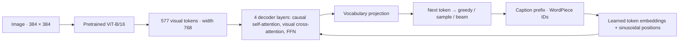

# Image Captioning: XE, REINFORCE, and SCST

A reproducible, CPTR-inspired image-captioning experiment on **Flickr30k**: a
pretrained ViT image encoder, a Transformer caption decoder, cross-entropy (XE)
training, and sequence-level reinforcement learning with CIDEr-D rewards.

The project asks whether direct caption-reward optimization improves an XE
captioner, and how a greedy self-critical baseline compares with raw-reward
REINFORCE under a shared training recipe.

**Experiment reset:** the previous SCST run was affected by a mixed-precision
weight-cache bug. The training code is fixed and regression-tested. Both RL runs
and their continuations have been deleted so REINFORCE and SCST can restart from
the same XE parent. All previous evaluation outputs, test predictions, charts,
and example galleries have also been removed. No replacement RL run has started.
See the [bug explanation](docs/SCST_AMP_AUDIT.md).

## Saved artifacts and next comparison

Only the XE training artifacts are retained under `artifacts/`:

- `artifacts/flickr30k/xe/`: original frozen-encoder XE run.
- `artifacts/flickr30k-xe-finetune-runpod/`: partially fine-tuned XE run;
  use `best.pt` as the common parent for new REINFORCE and SCST runs.

Start both RL methods as fresh runs, with the same XE checkpoint, seed, data,
learning rates, schedule, and epoch budget. Do not resume the deleted RL runs.
Choose checkpoints using validation, then rerun XE, REINFORCE, and SCST under
one fixed test protocol. Results and caption examples are pending those runs.
The test set has already been inspected previously; deleting outputs does not
make it unseen. Keep future choices based on training and validation.

## Model and design choices

This is a **CPTR-inspired adaptation**, not an exact reproduction of
[CPTR](https://arxiv.org/abs/2101.10804). Its dataset, tokenizer, architecture details,
and training recipe differ from the paper.



| Choice | Implementation and rationale |
| --- | --- |
| Pretrained visual features | Pinned `google/vit-base-patch16-384`; use all patch tokens and the CLS token from `last_hidden_state`, with no pooled classifier output. |
| Gradual visual adaptation | First train with the image encoder frozen, then unfreeze its last four blocks and final LayerNorm. This limits the number of visual parameters updated on Flickr30k; it is a chosen recipe, not a proven optimum. |
| Separate learning rates | A smaller encoder LR protects pretrained visual features while the caption decoder adapts more quickly. |
| Caption representation | Pinned `distilbert-base-uncased` WordPiece tokenizer; caption embeddings and decoder weights are learned by this project, not loaded from a pretrained language model. |
| Decoder | Width 768, 12 attention heads, four layers, FFN width 1536, ReLU, dropout 0.1, sinusoidal positions. Each cross-attention layer projects raw ViT memory directly; there is no additional shared memory-projection layer. |
| Image-level RL batches | One image per batch item with all five references avoids treating annotator captions as independent RL observations. |
| Fixed reward corpus | Training-caption document frequencies make CIDEr-D independent of the current minibatch. Validation/test references are not used to build that reward corpus. |
| Controlled evaluation | All methods share preprocessing, token constraints, output length, reference sets, and decoding settings. The method's training baseline is preserved in provenance. |

Augmentation occurs on PIL images before the pinned image processor normalizes
them. The Flickr30k runs use rotations up to 10 degrees and probabilistic
brightness jitter, with horizontal flips disabled. Validation and test images use
deterministic processing. All captions for an image stay in one split.

## Training objectives and experiment history

XE minimizes teacher-forced token cross-entropy over non-padding targets. RL
optimizes sampled captions using the shared sequence-policy loss:

$$
L_{\mathrm{RL}} = -\frac{1}{B}\sum_i \operatorname{stopgrad}(A_i)
\sum_t m_{i,t}\log p_\theta(y_{i,t}^{s}\mid y_{i,<t}^{s},x_i).
$$

The action mask includes the first EOS token and excludes every later action.
The only intended method difference is the advantage:

- **REINFORCE:** $A_i = r(y_i^s)$, a zero baseline.
- **SCST:** $A_i = r(y_i^s)-r(\hat y_i)$, using the model's greedy caption as the baseline.

The [SCST paper](https://arxiv.org/abs/1612.00563) uses the model's own test-time
inference reward as its baseline. Here, greedy generation runs in eval mode with
no gradients. Sampling also uses eval mode, which disables dropout but retains
autograd. Beam search is a separate evaluation factor; it does not change the
training baseline. Raw SCST and REINFORCE loss magnitudes are not comparable
quality measures, and negative SCST loss is not itself an error.

| Stage | Run and selection | Optimization |
| --- | --- | --- |
| Frozen-encoder XE | 10 completed epochs; best validation loss at epoch 7 | AdamW, warmup + cosine schedule; see original Flickr30k config |
| Partial-encoder XE fine-tuning | 4 completed epochs of a maximum 5; best at epoch 2 | Decoder/head LR `1e-5`, encoder LR `1e-6`, AdamW, 10% warmup + cosine, patience 2 |
| Independent RL runs | 15 epochs each from the same fine-tuned XE parent | Adam, batch size 16, decoder/head LR `1e-5`, encoder LR `1e-6`, exponential decay `0.85` per epoch |
| RL continuation | 8 additional epochs each, total 23 | Resume original decayed LRs and scheduler; `resume_use_config_lrs = false` |

The accepted continuation did not reset the learning rate. An abandoned constant-LR
trial is excluded from the retained final histories. Both methods use seed 42 and
29,000 training images per epoch, but equal epochs are not equal compute: SCST
adds a greedy rollout. Matching nominal settings did not guarantee matching
optimization behavior, as the AMP audit demonstrates.

## Cached inference and correctness

Greedy, sampled eval-mode, and **beam-search** decoding use incremental attention
KV caches. Each layer projects image keys/values once and appends caption
keys/values as tokens arrive. Beam children can share an immutable parent prefix;
extending one child creates a new cache without changing siblings. Completed
beams retain their score and are not decoded further.

Caching preserves the existing beam ranking, length penalty, special-token
masking, first-EOS masks, and stopping rule. `runtime.use_kv_cache = false` selects
the full-prefix reference implementation. Models without the incremental API and
train-mode sampling fall back to full-prefix decoding. Cache state adds no model
parameters and does not change checkpoint compatibility.

Cached beam decoding has regression coverage for equivalence with full-prefix
decoding. Saved evaluation and timing reports were removed during the reset;
rerun real-checkpoint verification before the next GPU evaluation.

Tests cover sibling branching and reordering, early EOS, mixed completion lengths,
beam width one, length limits, forbidden tokens, raw versus normalized beam scores,
checkpoint loading, and cached/full-prefix equivalence. Real-checkpoint checks
use 16 validation images for each selected model; a finite subset is evidence,
not a proof of bitwise equality for every possible image. Floating-point precision
can change close token/beam decisions, so final evaluations share one precision.

The **attention KV cache** and **autocast weight cache** are different mechanisms.
The SCST training fix disables only the latter around the baseline/sample pair.
See [the training audit](docs/SCST_AMP_AUDIT.md) for the historical defect and why
checking every trainable parameter's gradient matters.

## Reproduce the project

### Install and prepare data

Python 3.11–3.13 is supported. For local development:

```bash
uv sync --locked --extra dev --extra eval
uv run --with kagglehub python scripts/setup_flickr30k.py
uv run scst-captioner validate-data --config configs/flickr30k.toml
```

The setup script pins the Flickr30k image mirror and Karpathy annotation hashes,
keeps all five captions, and saves an image-level split manifest:

| Train | Validation | Test |
| ---: | ---: | ---: |
| 29,000 | 1,014 | 1,000 |

Images live under `data/flickr30k/`, with the manifest at
`data/splits/flickr30k.json`. Reruns verify existing data rather than silently
changing the split. Dataset files and large checkpoints are intentionally ignored
by Git. The pinned tokenizer and image processor may download on first use.

For GPU verification and evaluation, the Runpod PyTorch 2.8/CUDA 12.8 image
can use the constraints in `configs/evaluation-constraints.txt`. This differs
from the newer local development Torch lock. Inside that image:

```bash
uv venv --system-site-packages .venv
uv pip install --python .venv/bin/python -e '.[dev,eval]' \
  --constraint configs/evaluation-constraints.txt
apt-get update && apt-get install -y openjdk-21-jre-headless
```

Java is required for COCO PTB tokenization and METEOR. CIDEr-D training rewards do
not require Java. The optional `nltk_meteor` training reward requires separately
installed WordNet resources; it is not used in these experiments.

### Train or inspect a checkpoint

```bash
# Train the frozen-encoder XE model, then partially fine-tune its best checkpoint.
uv run scst-captioner train-xe --config configs/flickr30k.toml
uv run scst-captioner train-xe --config configs/flickr30k-xe-finetune.toml

# Start NEW RL experiments with corrected training code and separate output paths.
uv run scst-captioner train-rl --config configs/flickr30k-scst.toml \
  --xe-checkpoint artifacts/flickr30k-xe-finetune-runpod/best.pt \
  --output-dir artifacts/new-scst
uv run scst-captioner train-rl --config configs/flickr30k-reinforce.toml \
  --xe-checkpoint artifacts/flickr30k-xe-finetune-runpod/best.pt \
  --output-dir artifacts/new-reinforce
```

A fresh checkout does not contain the historical XE checkpoint. For your own run,
use the `best.pt` produced by the fine-tuning command, normally
`artifacts/flickr30k-xe-finetune/xe/best.pt`, as both RL parents.

`best.pt` is selected using validation; `last.pt` is for resuming. Checkpoints
contain weights, optimizer/scheduler/scaler state, RNG state, progress, resolved
configuration, and provenance. `xe.init_checkpoint` initializes a fresh run;
`--resume` restores training state. The opt-in constant-LR mode is available for
new experiments, but it is not the schedule used in the reported continuation.

### Evaluate and regenerate the report

After fresh training, configure the evaluation scripts to use the new run paths.
Their current default paths refer to the deleted runs and must be updated before
use. The reporting script also expects original and continuation histories.
The following commands describe the workflow, not currently available outputs:

```bash
# Compare cached and uncached beam inference on validation images.
.venv/bin/python scripts/verify_kv_cache.py \
  --checkpoint artifacts/new-scst/best.pt \
  --decoding beam --device cuda --images 16 \
  --output artifacts/beam-verification.json

# Six cells: XE / REINFORCE / SCST × greedy / beam-3.
.venv/bin/python scripts/evaluate_final_models.py --device cuda --amp

# Charts, test table, 12 example panels, and an HTML gallery from saved outputs.
.venv/bin/python scripts/report_final_models.py
```

The evaluation script refuses incompatible checkpoints and verifies both RL
models' common XE parent. `--resume` reuses completed cells only when source,
checkpoint, configuration, data, and prediction identities match. Results are
saved under `artifacts/final-evaluation/test/`; the gallery is under
`artifacts/final-evaluation/gallery/`. Future tables, charts, and example panels can be written under `docs/results/`
for README rendering; the previous outputs have been deleted.

For a single image:

```bash
uv run scst-captioner caption path/to/image.jpg \
  --config configs/flickr30k-reinforce.toml \
  --checkpoint artifacts/new-reinforce/best.pt \
  --decoding beam
```

### Checks and supporting tools

```bash
uv run pytest
uv run ruff check .
uv run ruff format --check src tests
```

The test suite uses small injected models and data without downloading datasets.
The saved-weight verification scripts complement those tests with actual models.
The [visual playground](notebooks/playground.ipynb) explains image preprocessing,
patches, caption tokens, masks, and tensor shapes. Flickr8K remains supported via
`configs/default.toml` and `scripts/setup_flickr8k.py`; its historical notebook
scores are not mixed into this Flickr30k report.

## Current limitations

A corrected SCST-versus-REINFORCE comparison requires fresh training from the
same XE parent, with gradients checked on the actual runtime before training.
The historical SCST bug prevents conclusions about relative algorithm quality.
Both old RL runs and all evaluation results have been removed. No corrected
training results or test-set claims are reported here.

A single shared seed and recipe would still be one controlled experiment, not a
statistical ranking of algorithms or a state-of-the-art claim. Equal epoch
budgets do not imply equal compute because SCST adds a greedy baseline rollout.

The current package supersedes the [legacy notebook](notebooks/legacy/ImageCaptioner.ipynb).
Earlier notebook scores used inconsistent protocols and unverified lineage.
The [original audit](docs/AUDIT.md), [experiment protocol](docs/EXPERIMENT_PROTOCOL.md),
[research alignment](docs/RESEARCH_ALIGNMENT.md), and
[checkpoint compatibility guide](docs/CHECKPOINT_COMPATIBILITY.md) preserve the
technical background.

Flickr images belong to their original owners and are not relicensed by this
repository. Example panels retain dataset image IDs. A code license has not yet
been selected; choose one deliberately before redistributing the project as open
source.
